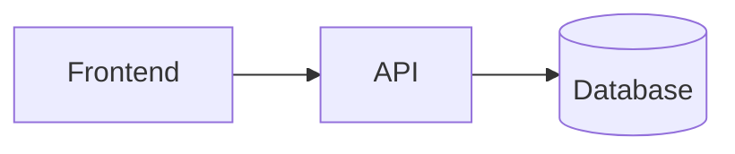

# Título del Proyecto

## Visión General

Descripción extendida...

## Arquitectura

## Funcionalidades

- Feature 1
- Feature 2

## Stack Técnico

| Capa | Tecnología |
|------|------------|
| Frontend | React |
| Backend | FastAPI |
| DB | PostgreSQL |

## Métricas

- Endpoints: X
- Cobertura tests: Y%
- Lighthouse: Z